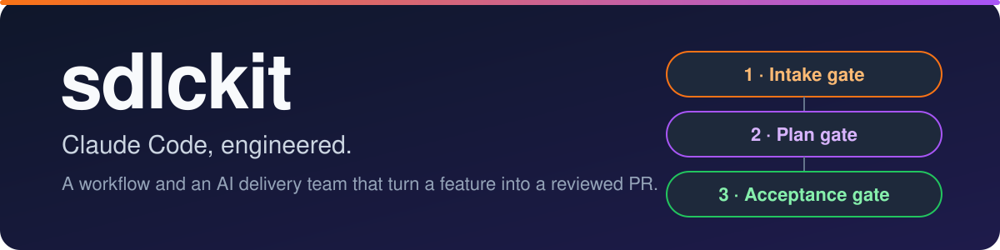
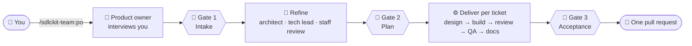
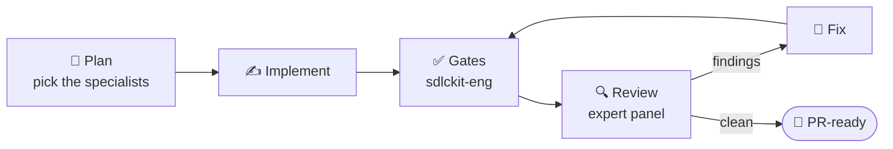

<p align="center">
  
</p>

<p align="center">
  <a href="https://github.com/arifshariati/sdlckit/actions/workflows/gates.yml"></a>
  <a href="https://github.com/arifshariati/sdlckit/releases/latest"></a>
  <a href="LICENSE"></a>
  
  
  <a href="https://github.com/arifshariati/sdlckit/issues"></a>
</p>

<h1 align="center">sdlckit</h1>

<p align="center">
  <b>An opinionated software delivery workflow for Claude Code, plus an AI delivery team<br>
  that takes a feature from your request to a reviewed, tested pull request.</b>
</p>

<p align="center">
  <a href="#-install">Install</a> ·
  <a href="#-quick-start">Quick start</a> ·
  <a href="#-whats-included">What's included</a> ·
  <a href="#-how-it-works">How it works</a> ·
  <a href="#-contributing">Contributing</a>
</p>

> [!NOTE]
> Status: pre-v1. Plugins validate with `claude plugin validate`. Expect changes before 1.0. See the
> [changelog](CHANGELOG.md) and [releases](https://github.com/arifshariati/sdlckit/releases).

---

## 🚀 Install

One command, from any shell:

```bash
claude plugin marketplace add arifshariati/sdlckit && claude plugin install sdlckit-team@sdlckit
```

`sdlckit-team` depends on the other packs, so this installs the whole kit. To install only the
engineering workflow, run `claude plugin install sdlckit-workflow@sdlckit` instead.

Inside Claude Code, the same steps are `/plugin marketplace add arifshariati/sdlckit` and
`/plugin install sdlckit-team@sdlckit`.

**Requirements:** Claude Code, Node.js 22 or later, and git. The bundled `sdlckit-eng` and
`sdlckit-delivery` commands are single self-contained files with no install step.

---

## ⚡ Quick start

In a repository you want to work on:

1. **Set up once.** `/sdlckit-workflow:eng-init` detects your stack, confirms the exact gate
   commands (format, lint, typecheck, test…) with you, and writes `.claude/engineering.json`. Say
   yes to the delivery team.
2. **Then either:**
   - 🛠️ **Make a change:** `/sdlckit-workflow:implement add rate limiting to the login endpoint`
   - 🧑‍💻 **Hand over a feature, or a list of them:** `/sdlckit-team:po saved payment methods`. The
     product owner interviews you, then the team plans, designs, builds and tests it. It comes back
     to you at three gates: intake, plan and acceptance.
3. **Check progress any time:** `/sdlckit-team:board` shows where every epic and ticket stands.

You can also just ask, in plain words: *"add saved payment methods"* or *"why is checkout slow?"*
The routing skill sends the request to the right workflow.

---

## 🧩 What's included

| Plugin | What it gives you |
|---|---|
| 🔧 `sdlckit-workflow` | `/implement`, `/fix`, `/investigate`, `/review`, `/pr-ready`, `/eng-init`, `/eng-learn`, `/eng-report`. Reviewers for architecture, code, security, testing, performance and PR readiness. The `sdlckit-eng` gate runner. |
| 🗄️ `sdlckit-backend` | NestJS, PostgreSQL and Supabase experts and rulebooks. |
| 🎨 `sdlckit-frontend` | React, React Native and Vite experts and rulebooks, plus **`ui-craft`**, the UI quality standard for Tailwind, shadcn and NativeWind. |
| ☁️ `sdlckit-infra` | AWS, Terraform and AI agent experts and rulebooks. |
| 🤖 `sdlckit-team` | The AI delivery team: product owner, business analyst, solution architect, tech lead, staff engineer, UI/UX designer, six domain engineers, QA, technical writer, DevOps and delivery manager. Commands `/po`, `/refine`, `/deliver`, `/accept`, `/board`, `/team`, and the `sdlckit-delivery` state machine. |

Commands are plugin-scoped: `/sdlckit-workflow:implement`, `/sdlckit-team:po`, and so on.
Experts fire only for domains your manifest marks as present, so unused packs cost nothing.

---

## 🔄 How it works

> **LLMs reason. Tools verify. CI enforces.**

Agents plan, write and review. The project's own gate commands, run by `sdlckit-eng`, decide whether
lint, typecheck and tests passed. No agent can declare a gate passed.

### 🧑‍💻 The delivery team: one epic, three gates

You approve at three points. Nothing is pushed until you accept the epic. Then it becomes one PR.



Every state change goes through `sdlckit-delivery`, which refuses a move until its evidence exists:
green gates and a clean review at the current commit, a QA verdict on the exact commit tested,
acceptance tests QA has locked, docs, and the merge. The team's records live in `.delivery/` in your
repository.

### 🛠️ The single-change workflow



### 💸 Efficient by design

Every agent runs on Haiku. Depth comes from effort: the hardest judgment calls (architecture,
decomposition, QA verdicts) get the highest effort, and work escalates to a higher effort only when
it fails.

Read more in each plugin's `docs/`: [`workflow.md`](plugins/sdlckit-workflow/docs/workflow.md) for
the engineering workflow, and [`team.md`](plugins/sdlckit-team/docs/team.md) for the delivery team.

---

## 🗑️ Uninstall

```bash
claude plugin uninstall sdlckit-team@sdlckit && claude plugin prune
```

`prune` removes the packs that were installed only as dependencies. Uninstalling a plugin also
removes its data folder (the workflow's metrics). Project files (`.claude/engineering.json` and
`.delivery/`) stay in your repositories until you delete them.

---

## 🤝 Contributing

Contributions are welcome. Start with [CONTRIBUTING.md](CONTRIBUTING.md): it covers setup, the
`pnpm gates` check, and DCO sign-off. Please follow the [Code of Conduct](CODE_OF_CONDUCT.md).

- 🐛 **Found a bug?** [Open an issue](https://github.com/arifshariati/sdlckit/issues/new/choose).
- 💡 **Have an idea?** Start a [discussion](https://github.com/arifshariati/sdlckit/discussions).
- 🔐 **Found a vulnerability?** Report it privately, as described in [SECURITY.md](SECURITY.md).

Content lives in `content/<pack>/`. `pnpm content:generate` builds `plugins/` and the marketplace,
and `pnpm gates` runs every check CI runs. The design decisions behind the project are recorded in
[docs/decisions.md](docs/decisions.md).

---

## 📄 License

MIT. See [LICENSE](LICENSE).
