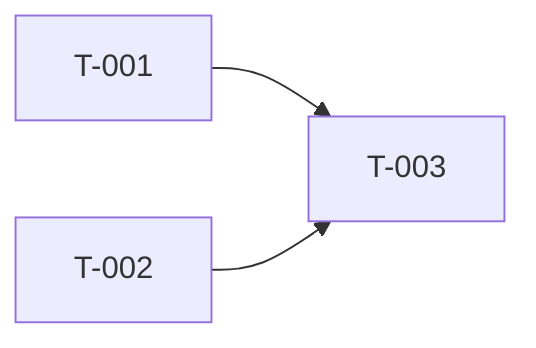

# Ticket rules

Spec: `${CLAUDE_PLUGIN_ROOT}/docs/team.md`. Tickets are created only with
`D new ticket --epic E-### --title "…" --domain <manifest domain> [--ui true] [--risk …] [--depends T-…] [--traces AC1,AC2]`
(`D` = `sdlckit-delivery`), then filled in by editing the file
(`D path T-###`). Never hand-edit `status`, `qa_round`, `red_gate_runs`, `effort_overrides`, or the
`## History` section (the script appends to it; explain revisions in your reply or in the section you changed).
Fields you may change later with `D set T-### key=value`: `title, domain, ui, risk, traces, depends_on, owner`.

## Project docs (manifest `delivery.docs`)
If the manifest has `delivery.docs`, the repo's own documents are binding context for your role:
read `delivery.docs.inputs` entries relevant to you (e.g. plan, UI strategy, gaps reports) before
working, cite their IDs (an epic's `ref`, plan IDs) instead of inventing new ones, write ADRs only via
`D new adr` (it lands in `delivery.docs.adrDir` in the repo's ADR style — match existing ADRs there),
and never hand-edit the table or pie in `delivery.docs.statusFile` (the script renders it).

## 1. Decomposition

- **One ticket = one domain = one engineer run = one reviewable change.** A ticket's `domain`
  must be a manifest domain with `present: true`; it selects the engineer (routing.md).
- **Size:** an engineer can finish it in one focused session — as a guide ≤ ~400 changed lines of
  non-test code, ≤ ~10 files. Larger → split. Trivially small (a constant, a label) → fold into a
  neighbour unless it must ship independently.
- **Slice by behaviour within a domain**, not by file type: "cart API: add/remove item" and "cart
  API: totals & discounts", not "cart controller" / "cart service".
- **Cross-domain features split per domain with an explicit contract.** The provider ticket
  (API, schema) owns the contract; the consumer ticket (UI, mobile) `depends_on` it and quotes the
  same contract in its Technical approach. The contract text must be identical in both.
- **Order of foundations:** data/migrations → backend contracts → clients (web/mobile) → polish.
  Infra/env/config prerequisites get their own small ticket early.
- **Keep the graph shallow and wide.** Prefer several tickets that depend on one contract ticket
  over long chains. No cycles. Every ticket must be startable once its `depends_on` are `done`.
- **No design tickets, no docs tickets, no QA tickets** — design is a stage of `ui:true` tickets,
  docs and QA happen inside every ticket.
- **Spikes are rare.** Resolve unknowns during refinement by reading the code. Only when an
  unknown cannot be settled without building, create a `risk: high` ticket whose TACs are
  "prototype demonstrates X" + "decision recorded in ADR-###", or escalate to *Decisions for you*.

## 2. Ticket acceptance criteria (TACs)

Format in `## Acceptance criteria`: `- [ ] TAC1: <criterion>` (QA later checks them off with evidence).
- Observable and binary. Each maps to a test QA can write: e2e, API/HTTP, DB query, unit, or a
  manual-visual check against `design.md`. If you cannot say how QA would prove it, rewrite it.
- Include at least one **negative/edge** TAC (invalid input, unauthorized access, empty state,
  provider failure) — especially for `risk: high`.
- Contract TACs are explicit: "`POST /cart/items` with an unknown productId returns 404 `{code:'PRODUCT_NOT_FOUND'}`".
- 2–6 TACs per ticket. `traces` lists the epic ACs this ticket advances; across the epic every
  AC must be traced (the script enforces it).

## 3. Technical approach (the engineer's brief)

`## Technical approach` must let a domain engineer start without re-deciding architecture:
- **Where:** modules/files likely touched (paths from the repo, verified by reading it).
- **Contract:** request/response or props/types, error shapes, events — copied from the epic's
  Architecture section / ADR when one exists.
- **Data:** migrations (separate step, reversible), RLS/authz rules, indexes.
- **Patterns to follow:** name an existing file in the repo that does the same kind of thing.
- **Test expectation:** which layers (unit/integration/e2e) the engineer adds; QA adds acceptance tests.
- **Out of scope:** what this ticket deliberately does not do (often another ticket's job).
- **Risks/notes:** feature flag, backwards compatibility, performance hotspots.
No pseudo-code walls; decisions and pointers, not the implementation.

## 4. Fields

| field | rule |
|---|---|
| `ui` | `true` if a user sees a new or changed screen/state/copy → design stage first |
| `risk` | `high`: money, auth/authz, personal data, destructive migration, external contract, security boundary · `small`: local, low blast radius, no contract change · else `normal` |
| `depends_on` | only hard prerequisites (contract or schema the ticket consumes) |
| `traces` | epic AC ids, e.g. `[AC1, AC3]` |
| `owner` | auto from domain; change only if routing says otherwise |

## 5. Definition of Ready (script-checked: `D dor T-###`)
domain present · ≥1 TAC with text · traces ≥1 AC · deps exist · `ui` and `risk` set ·
Technical approach non-empty. Plus (judgment, checked by staff-engineer/PO): TACs testable,
contract identical across provider/consumer, size within §1.

## 6. Epic `## Plan` section (tech-lead writes it)
```
| Ticket | Title | Domain | UI | Risk | Depends on | Traces |
|---|---|---|---|---|---|---|



Sequencing: waves that can run in parallel (respecting maxParallelEngineers).
Risks: top 3 delivery risks and mitigations.
```
